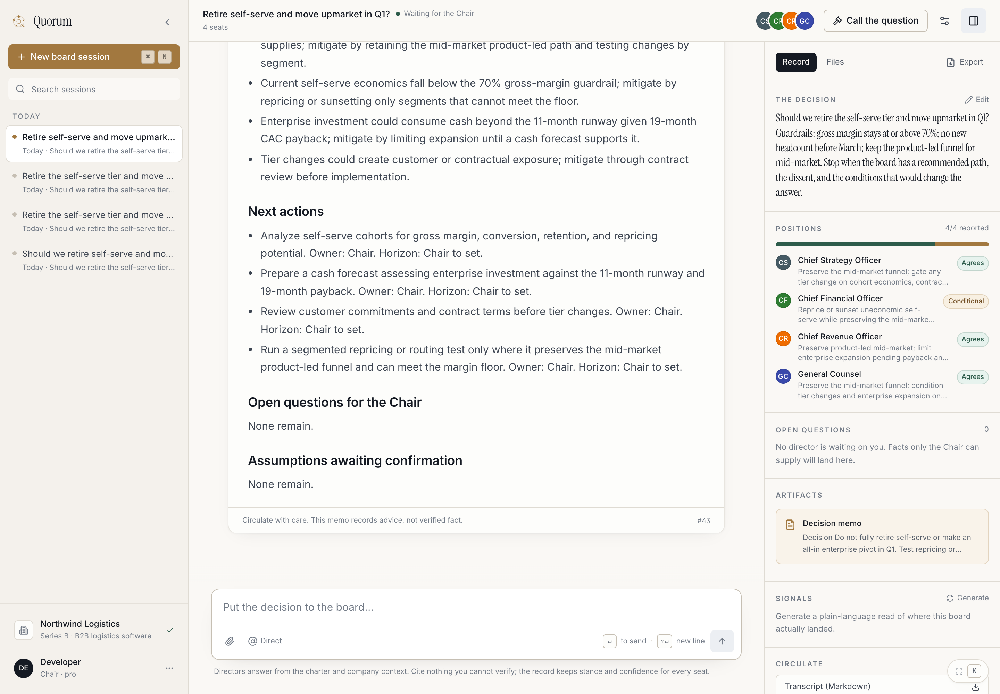
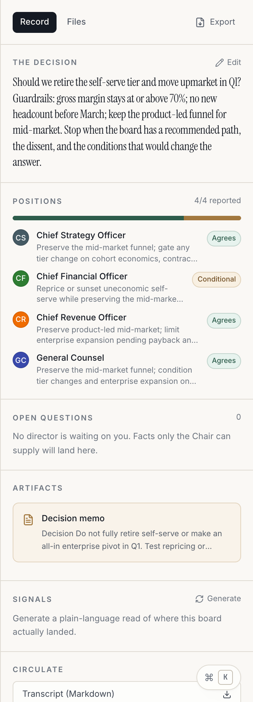
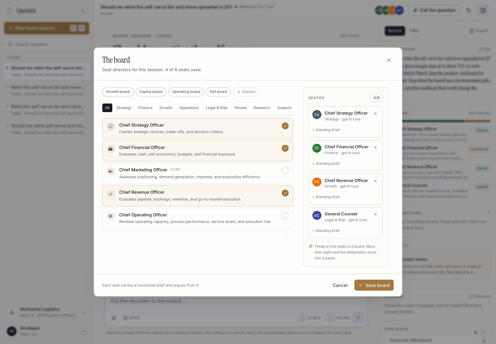
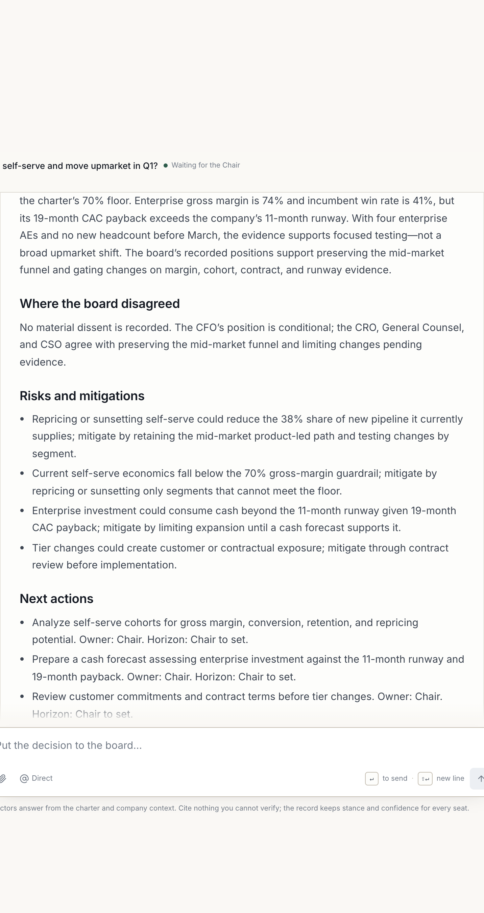

<p align="center">
  
</p>

<h1 align="center">Quorum</h1>

<p align="center"><strong>The AI boardroom for consequential decisions.</strong></p>

<p align="center">
  Seat a board of AI directors — finance, strategy, legal, operations — around one decision.<br>
  They deliberate in rounds, disagree on the record, and hand you a decision memo you can circulate.
</p>

---

## Why this exists

One-shot AI answers are confident, agreeable, and forgettable. Consequential decisions need the
thing a real board provides: **functional tension, a written record, and a memo that separates the
decision from the dissent.**

Quorum is a business rebuild of [ff-roundtable](https://github.com/0-CYBERDYNE-SYSTEMS-0/ff-roundtable).
The deliberation engine, streaming, turn fairness, deliverables, and open-question ledger are
proven there. Everything above them — domain, information architecture, prompts, and interface —
is rebuilt for operators.

## What it does

- **Convenes a board.** Four presets (Growth, Capital, Operating, Full) or fourteen individual
  functional seats, each with a standing brief: what it owns, what evidence it demands, and what it
  hands to another director.
- **Deliberates in rounds.** The moderator routes the next speaker from the state of the argument,
  not round-robin. Directors read each other, respond to a specific colleague, and must add
  something new or say they have nothing.
- **Records positions.** Every director closes with a stance — agree / conditional / disagree /
  abstain — plus a confidence score and a one-line position. The right rail tallies them.
- **Keeps the Chair in the room.** Pause, resume, direct a specific seat with `@[Role]`, answer an
  open question mid-session, or let the board run autonomously for a bounded number of turns.
- **Produces the artifact.** The closing synthesis is a decision memo: decision, rationale, where
  the board disagreed, risks and mitigations, next actions with owners and 30/60/90 horizons, open
  questions, and assumptions awaiting confirmation.
- **Builds deliverables.** The Chief of Staff can produce a memo, action plan, risk register, or
  30-60-90 plan as a versioned file. Charts and tables are artifacts, not screenshots.
- **Keeps a record you can audit.** Company context, charter, transcript, stances, artifacts, and
  deliverables persist in your database. Export any session as Markdown.

## Screenshots

| A session in progress | The decision record |
| --- | --- |
|  |  |

| Choose the board | The memo |
| --- | --- |
|  |  |

## Run it

Requirements: **Node.js 24+** and **PostgreSQL 14+**.

```bash
git clone https://github.com/0-CYBERDYNE-SYSTEMS-0/quorum.git
cd quorum
npm install
cp .env.example .env          # set DATABASE_URL, SESSION_SECRET, OPENROUTER_API_KEY
createdb quorum_dev
npm run db:init               # schema + pending migrations
npm run dev                   # http://localhost:5001
```

In development, `/auth` exposes a local sign-in for the seeded `developer` account. It is compiled
out of production builds.

### Environment

| Variable | Required | Purpose |
| --- | --- | --- |
| `DATABASE_URL` | yes | PostgreSQL connection string. Unset = in-memory storage (dev only). |
| `SESSION_SECRET` | yes | Express session signing key. |
| `OPENROUTER_API_KEY` | yes | House model key for directors. Directors can also use a user-supplied key. |
| `ENCRYPTION_KEY` | recommended | Encrypts stored user API keys. |
| `DEFAULT_AUX_MODEL` | optional | Model for routing, insights, and closing synthesis. |
| `STRIPE_SECRET_KEY` / `STRIPE_PRICE_ID_PRO` / `STRIPE_PRICE_ID_PRO_ANNUAL` | optional | Executive subscriptions. Without them every account stays on Associate and billing fails closed. |
| `LOCAL_AI_BASE_URL` / `LOCAL_AI_MODEL` | optional | Route director calls to a local OpenAI-compatible endpoint. |
| `PORT` | optional | Defaults to `5001`. |

Default director models are free-tier OpenRouter slugs and are verified before each release;
provider-side retirement is the usual cause of a 404 mid-session. Model slugs live in
`shared/expert-catalog.ts` (defaults) and can be overridden per seat in the board dialog.

## Deploy

**Docker / Compose** — build the image and run against Postgres:

```bash
docker compose up -d --build
```

**Replit** — the repo ships a `.replit` configuration for a Reserved VM or Autoscale deployment.
See [docs/DEPLOY.md](docs/DEPLOY.md) for the exact secrets, build command, and health check.

**Render** — `render.yaml` is a one-click blueprint (web service + managed Postgres). Set
`OPENROUTER_API_KEY` and `ALLOWED_ORIGIN`; the rest is generated.

**Any Node host** — `npm run build && npm start` serves the API and the built client from one port.

## Architecture

```
client/   React 18 + Vite + Tailwind, wouter routing, TanStack Query, WebSocket stream
server/   Express + ws
  orchestrator.ts   per-session state machine: routing, turns, pause/resume, snapshots
  ai.ts             prompts, streaming, stance parsing, closing memo
  expert-tools.ts   text-protocol research tools + deliverable parse/version/ownership
  routes.ts         REST, billing webhooks, authenticated WebSocket
  storage.ts        IStorage with PostgreSQL and in-memory implementations
shared/   Drizzle schema, board catalog, mentions, chart artifacts, pure helpers
```

The client subscribes to one session over an authenticated WebSocket. Tokens stream into a
transient map; completed turns land in the query cache; the server owns state and replays it on
reconnect. Paused sessions snapshot to storage and survive a restart.

### Design

A quiet, editorial system: warm paper (`#FAF7F1`), ink (`#151A21`), bronze (`#A2773E`) with a
matching dark palette. Instrument Serif for the product's voice, Inter for the interface, tabular
numerals for money. Hairlines and whitespace instead of shadows and cards-on-cards. Tokens live in
`client/src/index.css`; the full rationale is in [docs/DESIGN.md](docs/DESIGN.md).

## Verification

```bash
npm run check     # tsc, strict
npm test          # vitest
npm run build     # client + server bundles
```

The suite covers routing, turn fairness, response hygiene, citations, deliverables and
versioning, open questions, auth, billing errors, and WebSocket scoping. Tests force
`DATABASE_URL=""` and run against in-memory storage, so no database is needed.

## Limitations, stated plainly

- Directors give **advice**, not legal, tax, or investment fact. The General Counsel seat says so
  in every relevant answer.
- The board does not verify your numbers. It will demand them, label assumptions, and refuse to
  invent a figure — but garbage in is still garbage out.
- Charts use only numbers supplied in the session or retrieved this turn; a chart with no real data
  is refused rather than drawn.
- Billing is optional. Without Stripe configured, the product runs on Associate limits and says so.

## License

MIT. Built by [0-CYBERDYNE-SYSTEMS-0](https://github.com/0-CYBERDYNE-SYSTEMS-0).
